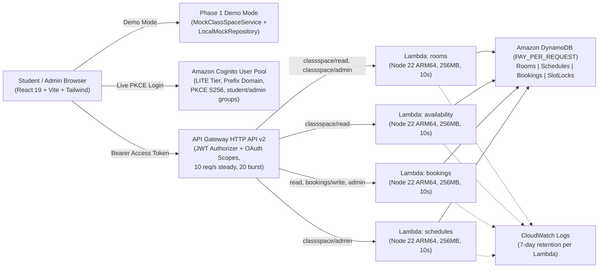

# ClassSpace — System Architecture

ClassSpace is a full-stack serverless platform for **schedule-based classroom availability discovery and booking management** on college campuses (`Asia/Kolkata` timezone, `ap-south-1` Mumbai target region).

> **Honest Scope Disclosures:**
> 1. All seed timetable records and Block-A classrooms represent demonstration / admin-entered records — **no live institutional ERP/timetable feed** is connected.
> 2. **`SCHEDULE_VACANT` does not prove physical room vacancy** (e.g., ad-hoc study groups or unscheduled sessions without sensors). Every UI availability result carries an explicit physical occupancy notice.
> 3. **Deployment Status:** Backend CDK stack and modular Lambda handlers are implemented and synthesized locally (`cdk synth --no-lookups`), and frontend runs live or in **Phase 1 Demo Mode**. Cloud provisioning awaits user AWS credentials & Free Plan / credit confirmation.

---

## High-Level Architecture

---

## Frontend Architecture (`D:\ClassSpace\src`)

- **Dual-Mode Service Abstraction (`IClassSpaceService`):**
  - **Demo Mode (`MockClassSpaceService` + `LocalMockRepository`):** Preserves 100% of Phase 1 offline demonstration behavior with persistent browser `localStorage` simulation and role switcher (`Student Demo` / `Admin Demo`).
  - **Live Mode (`AwsClassSpaceService` + `cognitoAuth.ts`):** Authenticates via Cognito Hosted UI Authorization Code + PKCE (`S256`), keeps tokens **strictly in memory**, injects `Authorization: Bearer <accessToken>`, and sends `Idempotency-Key` on booking creation.
- **Mode & Role Contexts:**
  - `AppModeProvider` (`src/app/AppModeProvider.tsx`) switches seamlessly between `DEMO` and `LIVE` modes via `src/services/index.ts`.
  - `AdminRoleGate` (`src/components/layout/AdminRoleGate.tsx`) enforces Demo Role in Demo Mode and requires authenticated Cognito `admin` group membership in Live Mode.

---

## Backend Serverless Architecture (`D:\ClassSpace\infra`)

### Modular Domain Lambdas (`infra/lambda/handlers/`)

| Function Name | Handler Entry | Memory / Timeout | Routes Handled |
| :--- | :--- | :--- | :--- |
| `classspace-dev-api-rooms` | `lambda/handlers/rooms.ts` | 256 MB / 10s | `GET /rooms`, `GET /rooms/{roomId}`, `POST /admin/rooms`, `PATCH /admin/rooms/{id}` |
| `classspace-dev-api-availability` | `lambda/handlers/availability.ts` | 256 MB / 10s | `GET /rooms/available` |
| `classspace-dev-api-bookings` | `lambda/handlers/bookings.ts` | 256 MB / 10s | `POST /bookings`, `GET /bookings/me`, `GET /bookings/{id}`, `PATCH /bookings/{id}/cancel`, `GET /admin/bookings`, `PATCH /admin/bookings/{id}` |
| `classspace-dev-api-schedules` | `lambda/handlers/schedules.ts` | 256 MB / 10s | `PUT /admin/timetable`, `POST /admin/restrictions`, `GET /admin/schedules`, `DELETE /admin/schedules` |

### Concurrency & Availability Model
1. **15-Minute Half-Open Slot Locks (`ClassSpaceSlotLocks`):** Intervals `[startTime, endTime)` decompose into deterministic keys (`roomId#YYYY-MM-DD#HH:mm`) verified via strongly consistent `BatchGetItem` and claimed atomically via `TransactWriteItems`.
2. **Non-Blocking Pending Requests:** `PENDING` student requests do **not** claim locks and never block `SCHEDULE_VACANT` availability until an administrator transitions them to `APPROVED`.
3. **Atomic Approval (`TransactWriteItems`):** Atomically asserts `attribute_exists(roomId) AND active = true`, transitions `PENDING -> APPROVED`, and inserts all required `SlotLockRecord` rows with `attribute_not_exists(lockKey)`. Concurrent winners claim the slot; losers deterministically receive `409 CONFLICT`.
4. **Owned Lock Release:** Cancellation and schedule deletion condition every `Delete` on `claimType = :expected AND claimRefId = :id` so one record can never release locks belonging to another.
